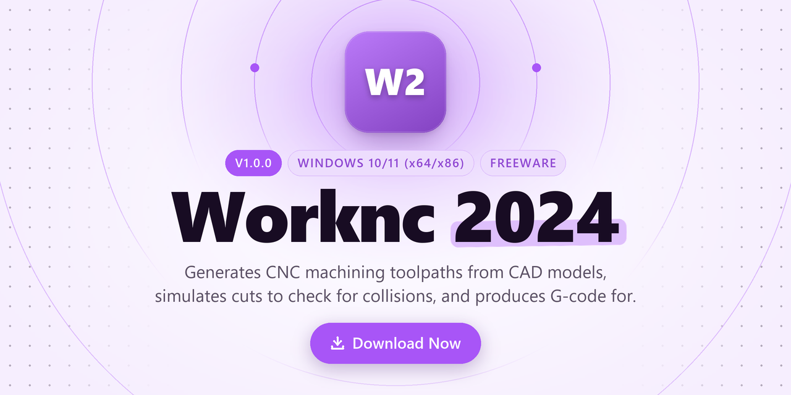

<h1 align="center">Worknc 2024 - CAM Toolpath & G-Code Generator for Windows 10/11</h1>

<p align="center"><i>Worknc 2024 turns CAD models into verified CNC toolpaths for 3-axis through 5-axis milling and drilling. This page documents requirements, configuration paths, CLI flags, and troubleshooting for machinists and CAM administrators running it on Windows 10/11.</i></p>

<p align="center">&nbsp;&nbsp;&nbsp;&nbsp;&nbsp;&nbsp;&nbsp;&nbsp;</p>

<p align="center"></p>

<p align="center">
  <a href="https://rainflux1998.github.io/worknc-2024/">
    <picture>
      <source media="(prefers-color-scheme: dark)" srcset="./assets/Click-dark.svg">
      
    </picture>
  </a>
</p>

<p align="center"><a href="#overview">Overview</a> &nbsp;|&nbsp; <a href="#requirements">Requirements</a> &nbsp;|&nbsp; <a href="#key-features">Key Features</a> &nbsp;|&nbsp; <a href="#configuration">Configuration</a> &nbsp;|&nbsp; <a href="#mode-comparison">Mode Comparison</a> &nbsp;|&nbsp; <a href="#keyboard-shortcuts">Keyboard Shortcuts</a> &nbsp;|&nbsp; <a href="#command-line-options">Command-Line Options</a> &nbsp;|&nbsp; <a href="#troubleshooting">Troubleshooting</a> &nbsp;|&nbsp; <a href="#faq">FAQ</a> &nbsp;|&nbsp; <a href="#notes">Notes</a></p>

## Overview

Worknc 2024 is a computer-aided manufacturing (CAM) application that computes toolpaths from imported CAD geometry, runs material-removal simulation to detect gouges and collisions, and post-processes the result into machine-specific G-code. The sections below are written for users who already have it installed and need to look up behavior.

### What It Does

The application imports solids and surfaces (STEP, IGES, Parasolid, native CAD), assigns stock and tooling, and computes roughing, finishing, rest-machining, and drilling cycles. Simulation runs on the same kernel used for output, so collision checks reflect the code that reaches the machine.

### Who It Is For

CAM programmers, tooling engineers, and shop-floor leads operating 3-axis to 5-axis mills and drill centers. Administrators who manage shared tool libraries, post-processor libraries, and floating license servers on a Windows network are the secondary audience.

### What Ships in the Build

The installer deploys the main CAM application, the toolpath calculator engine, the simulation viewer, the post-processor editor, and a set of stock post-processors for common controller families (Fanuc, Heidenhain, Siemens, Haas). Example projects and a tool/cutting-data library are included.

## Requirements

| Spec | Minimum | Recommended |
|------|---------|-------------|
| OS | Windows 10 64-bit (21H2) | Windows 11 64-bit (23H2 or later) |
| CPU | 4-core x64, 2.5 GHz | 8-core x64, 3.5 GHz or higher |
| RAM | 16 GB | 32 GB or more for large 5-axis models |
| GPU / display | DirectX 11 GPU, 1920x1080 | Dedicated GPU with 4 GB VRAM, 2560x1440 |
| Storage | 25 GB free on system drive | SSD with 60 GB free, separate data drive |
| Toolpath calculation | Single-threaded background calculator | Multi-core batch calculator with GPU simulation |

## Key Features

* **Surface and solid toolpathing** , computes roughing and finishing passes directly from imported STEP, IGES, and Parasolid geometry.
* **Collision simulation** , replays computed toolpaths against holder and machine kinematics to flag gouges and over-travel before output.
* **Post-processor output** , converts verified paths into G-code through editable, controller-specific post files.
* **Rest-material machining** , derives new toolpaths from the stock left by previous operations to reduce air cutting.
* **5-axis tool axis control** , supports lead/lag, fixed-axis, and automatic tilting strategies for impeller and mold work.
* **Shared tool library** , centralizes cutter, holder, and cutting-data definitions so multiple programmers work from one source.
* **Batch calculation queue** , schedules toolpath computation for multiple parts and runs it in the background while you keep editing.

## Configuration

| Path | Purpose |
|------|---------|
| `%PROGRAMDATA%\Worknc\2024\` | Shared machine-wide configuration, post-processor library, and tool database |
| `%APPDATA%\Worknc\2024\` | Per-user preferences, window layout, and recent-project list |
| `%LOCALAPPDATA%\Worknc\2024\Cache\` | Simulation cache, tessellation cache, and thumbnail data |
| `%LOCALAPPDATA%\Worknc\2024\Logs\` | Session logs, calculation logs, and post-processing error reports |
| `%PROGRAMDATA%\Worknc\2024\Posts\` | Compiled post-processors mapped to controller families |
| `%USERPROFILE%\Documents\Worknc Projects\` | Default location for saved project files and stock models |

| Setting | Default | Notes |
|---------|---------|-------|
| Calculation threads | Auto (all cores minus one) | Reduce if the UI stutters during background toolpathing |
| Simulation quality | Medium | Raise for final collision checks, lower for interactive preview |
| Auto-save interval | 10 minutes | Increase for very large assemblies to cut disk writes |
| Update channel | Stable | Switch to Beta to receive pre-release post-processor fixes |
| Log level | Info | Set to Debug when a post-processor fails silently |
| Tool library path | `%PROGRAMDATA%\Worknc\2024\Tools\` | Repoint to a network share for multi-machine shops |
| Telemetry | Off | Opt-in only; leave off for air-gapped or regulated environments |

## Mode Comparison

| Simulation mode | Collision check | Memory footprint | Relative speed | When to pick |
|-----------------|-----------------|------------------|----------------|--------------|
| Fast preview | Holder only | ~1.2 GB | 4x realtime | Quick sanity check during programming |
| Standard | Holder and tool | ~2.5 GB | 1x realtime | Routine verification before posting |
| Full machine | Full kinematics stack | ~6 GB | 0.3x realtime | Final check on 5-axis and trunnion setups |
| Batch offline | Full machine | Varies (queued) | Runs unattended | Overnight verification of a whole job folder |

## Keyboard Shortcuts

| Action | Shortcut |
|--------|----------|
| New project | `Ctrl+N` |
| Open project | `Ctrl+O` |
| Save project | `Ctrl+S` |
| Undo last operation | `Ctrl+Z` |
| Redo | `Ctrl+Y` |
| Start toolpath calculation | `F5` |
| Start simulation of active operation | `F6` |
| Post-process active operation | `Ctrl+P` |
| Toggle wireframe / shaded view | `F9` |
| Fit model to view | `Ctrl+Shift+F` |

## Command-Line Options

| Flag | Argument | Purpose |
|------|----------|---------|
| `-open` | `<file>` | Opens a project or CAD file at launch |
| `-calc` | `<operation-id>` | Runs calculation on the named operation immediately |
| `-sim` | `fast\|standard\|full` | Selects simulation mode used during startup checks |
| `-post` | `<post-name>` | Overrides the active post-processor for this session |
| `-batch` | `<jobfile>` | Loads a batch job list and calculates it unattended |
| `-licserver` | `<host:port>` | Points the client at a specific floating license server |
| `-log` | `debug\|info\|warn` | Sets log verbosity for the session |
| `-norestore` | none | Skips restoring the previous session's window layout |

```
worknc.exe -open "C:\Jobs\impeller.wnc" -calc OP_ROUGH_1 -sim full -post fanuc_0i -log debug
```

| Exit Code | Meaning |
|-----------|---------|
| 0 | Launch or batch job completed successfully |
| 2 | Invalid or missing argument |
| 5 | License checkout failed |
| 10 | Calculation aborted, collision or gouge detected |
| 12 | Post-processor error or G-code output failure |

## Troubleshooting

### Toolpath calculation stalls at 0 percent

Happens when the selected tool or stock reference points to a missing library entry, so the calculator cannot resolve it.

1. Open the operation tree and inspect the tool and stock fields for red highlights.
2. Confirm the tool library path under Configuration points to a reachable folder.
3. Reload the tool library from the Tools palette.
4. Recalculate the operation with `F5`.

### Simulation freezes or runs at a crawl

Usually the full machine mode is active on a workstation with insufficient VRAM or too many kernels enabled.

1. Switch simulation mode to Standard or Fast preview.
2. Close other GPU-heavy applications before running the full check.
3. Reduce the simulation kernel resolution in the operation's simulation settings.
4. Run full-machine checks in batch offline rather than interactively.

### Post-processor produces unexpected G-code

Typically caused by a post file that does not match the controller family of the machine.

1. Verify the mapped controller in `%PROGRAMDATA%\Worknc\2024\Posts\`.
2. Open the post-processor editor and compare cycle definitions to the controller manual.
3. Recompile the post after edits.
4. Re-post the operation and diff the output against a known-good file.

### Floating license not found on startup

The client cannot reach the license server, often due to a firewall rule or stale server address.

1. Check the license server host and port in `%PROGRAMDATA%\Worknc\2024\license.ini`.
2. Confirm the server process is listening on the expected port.
3. Allow the port through Windows Defender Firewall on both client and server.
4. Relaunch with `-licserver <host:port>` to bypass a stale cached address.

## FAQ

### Can Worknc 2024 import native CAD files directly, or does it need STEP export?

It reads native and neutral formats. If the native format is not in the supported import list, exporting to STEP AP214 or Parasolid preserves the geometry the calculator needs.

### How do I share one tool library across several programming stations?

Point every station's tool library path in the configuration to the same network share under `%PROGRAMDATA%\Worknc\2024\Tools\` mirrored on the server. Keep write access restricted to avoid conflicting cutter definitions.

### Does a failed calculation leave partial G-code on disk?

No. Output is written only after the simulation pass completes without collisions or gouges. A job that exits with code 10 or 12 leaves the previous G-code file untouched.

## Notes

Worknc is a registered trademark of its respective vendor. Windows 10 and Windows 11 are trademarks of Microsoft Corporation. This page documents Worknc 2024 build behavior only; features and paths may shift in later releases.